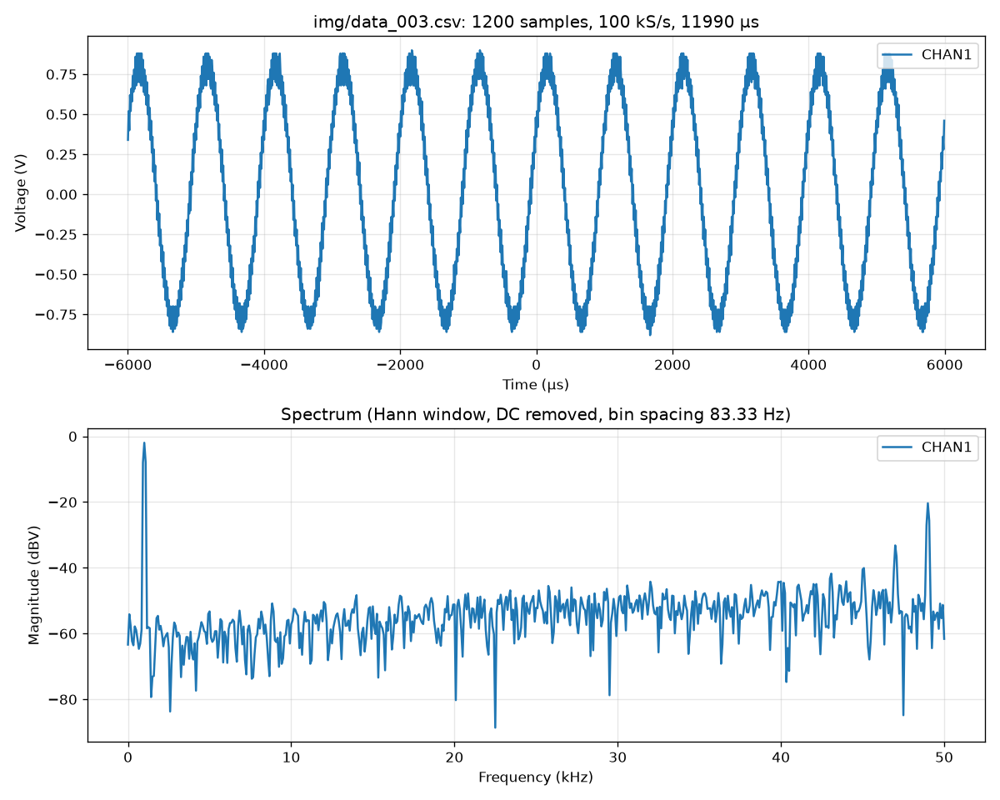

# rigol

Command-line tools for a Rigol DS1054Z oscilloscope, using the [ds1054z](https://github.com/pklaus/ds1054z) library:

- `scope.py` captures screenshots and waveform data from the scope.
- `fft.py` plots the time-domain trace and FFT spectrum of a captured CSV file.

## Usage

### scope.py

```sh
# Capture a screenshot: saves as prefix_000.png, prefix_001.png, ...
./scope.py prefix

# Capture waveform data for all displayed channels as CSV
./scope.py prefix --csv

# Specify the scope's IP address (default: 192.168.0.12)
./scope.py prefix --ip 192.168.1.50
```

### fft.py

```sh
# Plot the waveform and its spectrum in a window
./fft.py prefix_000.csv

# Save the plot as a PNG instead
./fft.py prefix_000.csv --save spectrum.png
```

The spectrum uses a Hann window with the DC offset removed, shown in dBV. The frequency resolution and maximum frequency come from the capture's sample rate and record length, so adjust the scope's timebase to suit the noise you want to look at.

## Setup

```sh
python3 -m venv .venv
source .venv/bin/activate
pip install -r requirements.txt
```

## Examples

### Screen capture


### FFT script output

Example input csv file is in [data_003.csv](./img/data_003.csv).

```sh
./fft.py img/data_003.csv --save img/spectrum_003.png
CHAN1:
  Peak 1: 1.00 kHz  -2.0 dBV
  Peak 2: 49.00 kHz  -20.4 dBV
  Peak 3: 47.00 kHz  -33.2 dBV
  Noise floor (median): -54.2 dBV
img/spectrum_003.png
```


